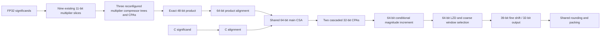

# Exact FMA with reconfigured multiplier slices

This experiment tests whether idle multiplier resources and a narrow normalization
window reduce the area of the existing exact Unified DPA16. It preserves all 55
scalar opcodes, all seven tensor formats, the regular EX2/EXP polynomial, and the
mutually exclusive tensor/scalar issue model. The comparator is the measured
`VX_ucc_v4_anchor_crop_comb` implementation, 39,809.826 um2 at 5 ns.

## Implemented candidates

| Top suffix | Product reduction | Accumulation | Normalization | C alignment |
|---|---|---|---|---|
| `anchor_crop_comb` (previous) | Nine weighted products in main CSA | 80-bit main CSA and positive/negative final adders | Existing full-width RTL | Existing aligner |
| `window_comb` | Unchanged | Unchanged, 80 bits | Coarse window selection, 39-bit fine shift, 32-bit output | Unchanged |
| `segmented_comb` | Reconfigured internal reduction of three remaining multiplier slices | 64-bit main CSA, two cascaded 32-bit CPAs, magnitude increment | Same narrow window, 64-bit source | Existing aligner |
| `segmented_align_comb` | Same as segmented | Same as segmented | Same as segmented | Three more existing multipliers perform fine alignment |

The RTL modules have the prefix `VX_ucc_v4_`. These are full UCC comparisons,
not FMA-only area estimates. All previous configuration defaults remain available.

### Actual multiplier reuse

The first nine 11-bit slices multiply the unsigned 11+11+2 significand chunks.
Their nine products contain all 48 exact product bits. No BF16 rounding occurs.
Simply computing more products cannot recover precision lost in later alignment.

`VX_ucc_mul_reducer` replaces slices 9--11 with a reconfigurable compressor network:

- Tensor/integer mode: three independent 11-by-11 products, with carries blocked
  at 22-bit boundaries.
- Scalar FP mode: the same compressor gates reduce the nine weighted products;
  three 22-bit final adders connect their carries to reconstruct the exact product.

This is a new shared compressor organization, not three additional multipliers
or an assertion that the original multiplier is freely reconfigurable. The input
muxes and boundary controls are included in synthesis. Slices 12--15 retain their
original functions. The alignment candidate additionally switches slices 12--14
to multiply C's three chunks by a one-hot value, performing a 0--7-bit fine shift.
A fixed-step coarse selector and sticky reduction still remain. The old alignment
resource remains available for conversions and EX2/EXP.



This design still has a 64-bit main reduction tree, wide sticky/LZD information,
and a 64-bit conditional increment. It does **not** reduce the entire datapath to
32 bits. The window candidate alone retains the 80-bit accumulator and LZD.

### Precision policy

Finite operands are represented as integer significands times powers of two.
The product top bound is obtained from the two input leading-zero counts, so it
differs from the actual product top by at most one bit; C's top is exact. The
64-bit window places the larger top bound at bit 61, leaving sign/addition room.
Product and C each undergo a single alignment with jammed discarded bits.

When the operands can nearly cancel, their 48-bit and 24-bit significands fit in
this window without truncating nonzero bits. If a nonzero product tail falls below
the window, that product's top is at most bit 46, while the dominant operand's top
is at least bit 60. There is then no severe cancellation; jammed tail information
lies well below the retained rounding field. The corresponding bound for C is
stronger. Subnormal results use the fixed FP32 subnormal quantum.

The regression includes `(1 + 2^-23)^2 - (1 + 2^-22) = 2^-46`, along with
subnormal products, opposite signs, and directed rounding. Four rounding modes,
canonical NaNs, gradual underflow and the existing exception policy are preserved.
This reasoning and extensive differential testing are not an all-input formal
proof. EX2/EXP remain approximate, as in the previous full exact-FP configuration.

## Verification and reproducibility

The standalone mathematical model passed 1,106,436 comparisons against the
independent exact-integer FMA oracle, including 400,004 newly generated cases.
The hardware primitive test passed 200,000 mode-switch cases, checking 600,000
multiplier/reduction outputs, 400,000 shift/sticky outputs, 200,000 signed
accumulations and 200,000 multiplier-assisted alignments. The latter test covers
every signed 12-bit shift distance. It exposed a coarse-distance overflow near
+2047, fixed by computing the rounded distance in 13 bits.

Each full RTL build runs 928,532 checks: 185,536 scalar FP, 101,536 integer,
608,691 auxiliary and 32,769 tensor cases. The additional directed replay runs
920,900 FP, 101,536 integer, 147,516 high-precision EXP and 58,525 tensor checks.
Counts describe executions; some inputs overlap between suites.

All three candidates passed both complete RTL suites and all 23,008 mapped
checks apiece, with no result, exception-flag or predicate mismatches. Each
candidate executes 1,106,436 scalar FP comparisons across the two RTL suites.

All three protocol configurations pass 6,161 accepted / 6,143 retired
transactions, with 18 intentionally reset-discarded transactions, 4,541 stalled
cycles and 1,000 consecutive II=1 acceptances. Flags and predicates are checked
through backpressure. The public `VX_ucc_stream` selects the window candidate
with `EXACT_FP=1, FMA_STYLE=3, WINDOW_NORM=1`, the segmented candidate with
`EXACT_FP=1, FMA_STYLE=4`, and multiplier-assisted alignment with
`EXACT_FP=1, FMA_STYLE=5`; all use `EXP_STYLE=1`.

Reproduce the two main builds with:

```sh
python3 hw/unittest/ucc/run.py segments --label final
python3 hw/unittest/ucc/segmented_check.py
python3 hw/unittest/ucc/run.py v4_exact_exp --width 64 --parameter FMA_SEGMENTED=1 --parameter WINDOW_NORM=1 --parameter DIRECT_NORM=1 --parameter EXP_CONST=1 --label segmented
python3 hw/unittest/ucc/run.py v4_exact_exp --parameter FMA_ANCHORED=1 --parameter FMA_CROP=1 --parameter WINDOW_NORM=1 --parameter DIRECT_NORM=1 --parameter EXP_CONST=1 --label window
python3 hw/unittest/ucc/run.py v4_exact_exp --width 64 --parameter FMA_SEGMENTED=1 --parameter WINDOW_NORM=1 --parameter DIRECT_NORM=1 --parameter EXP_CONST=1 --parameter MUL_C_ALIGN=1 --label segmented_align_checked
python3 hw/unittest/ucc/segmented_regression.py ucc_v4_exact_exp_w64_segmented ucc_v4_exact_exp_window ucc_v4_exact_exp_w64_segmented_align_checked
```

The mathematical/directed scripts reuse the prior general, subnormal, dominance
and high-precision EXP vector sets under `build_ucc`; their filenames and SHA256
hashes are recorded in the replay manifests. They fail if a prerequisite is absent.
Each compiled RTL build records source/configuration hashes separately. The
early alignment build and synthesis snapshot ending in
`superseded_distance12` are excluded from final evidence.

Synthesize each top with `bash hw/syn/ucc/run.sh <top>`, then run
`python3 hw/syn/ucc/gate_unified.py exact --top <top> --label <distinct_label>`.
Each mapped replay checks 23,008 results including flags, predicates and all
tensor formats. Frozen preprocessed sources, timing constraints and mapped
netlists remain under `build_ucc/ucc_synth/<top>`.

Generate the combined machine-readable evidence with
`python3 hw/syn/ucc/segmented_report.py`. It rejects incomplete synthesis, stale
gate hashes, failed RTL or missing directed replays. Later explicit `begin/end`
style edits to the three new primitives are covered by their final test;
frozen mapped netlists retain their original source hashes. The first two
synthesis snapshots also precede the optional C-multiplier routing, which is
disabled in those configurations. Current-versus-frozen source hashes are
listed explicitly; their area is not silently attributed to a later RTL revision.

## Measured area and timing

| Full exact UCC | Cell area (um2) | Change versus previous exact | Longest path (ns) |
|---|---:|---:|---:|
| Previous anchored/cropped | 39,809.826 | Reference | 5.000 |
| Narrow normalization window | **39,430.188** | **-379.638 (-0.954%)** | 5.000 |
| Reconfigured multiplier reduction + 64-bit accumulation | 39,540.816 | -269.010 (-0.676%) | 5.000 |
| Above + multiplier-assisted C alignment | 39,635.316 | -174.510 (-0.438%) | 5.000 |

The conditions match the previous comparison: Genus 21.10, TSMC N28 TT 0.8 V 25 C, RVT/HVT/LVT,
5 ns combinational delay, 50 ps input slew, 5 fF output load and ZeroWireload.
The elastic output register is excluded consistently. These measurements do not
establish a 1 GHz pipeline or post-route timing.

The narrow-window candidate is the minimum in this experiment. Exact mode in
`VX_ucc_stream` now defaults to `FMA_STYLE=3, WINDOW_NORM=EXACT_FP`, selecting
that implementation when `EXACT_FP=1`. Native mode retains its prior default.
`WINDOW_NORM=0` explicitly reproduces the earlier exact configuration.
The selected exact parameter combination already passed the full protocol test;
the default-parameter elaboration is additionally linted.

Compared with the window candidate, replacing the multiplier reduction and
accumulation costs a net **110.628 um2** in this mapping. Adding multiplier-assisted
C alignment then costs another **94.500 um2**. Thus the tested reuse mechanism
is functionally feasible, but it does not improve area beyond the narrower
normalization implementation. The recommended implementation retains its
80-bit accumulator; the optional segmented implementation uses 64 bits.

The segmented critical path starts at `op[1]`, passes through an ordinary
multiplier and the three chained 22-bit adders in the reconfigured multiplier
group, and ends at `result[6]`. This is direct evidence of serial carry-propagation
cost. The window and alignment candidates' worst paths start at `a[0]` and end
at `result[4]` and `result[2]` respectively. All three have zero reported slack
at the 5 ns target; no extra timing margin is claimed.

Hierarchy attribution in `ucc_segmented_measurements.json` is deliberately
partial: Genus flattens shifters, compressor gates and muxes into surrounding
logic. For example, the separately retained reconfigured-multiplier category
does not include every gate used by that mechanism. The whole-core differences
above include routing, buffering, sizing and mapping interactions; they are not
isolated gate-area charges for a shifter or adder alone. Vectorless power is
recorded in the JSON with its activity limitation, not promoted as workload power.

## Further optimization

The most useful follow-up is to reduce the serial carry chain while retaining
the shared compressor gates. A local carry-lookahead/bypass scheme or a design
that defers product carry propagation to the main accumulation could be compared
under the same 5 ns constraint. The latter needs a new precision argument for
alignment and cancellation; separately jamming sum/carry rows is not automatically
IEEE exact. Close/far cancellation paths are another possible experiment.
Neither is implemented or assigned an area estimate here.
