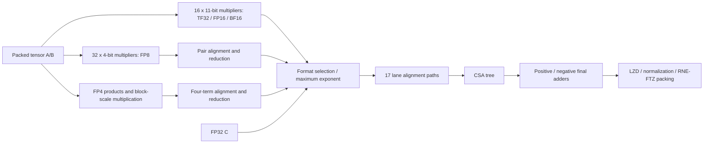
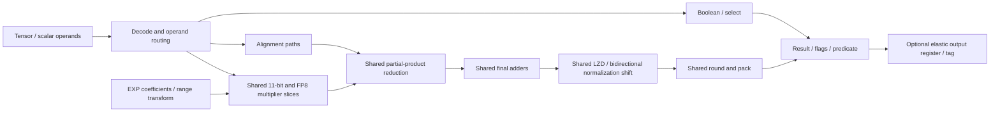

# Unified DPA16 arithmetic core

The objective is a single execution unit that preserves TF32 DP8, FP16/BF16
DP16, FP8 DP32 and FP4 DP64 throughput while sharing its arithmetic hardware
with scalar FP32, integer and approximate special-function operations. Tensor
and scalar modes are mutually exclusive. The source baseline is the Vortex TFR
implementation; it does not represent proprietary NVIDIA RTL.

The [exact-FMA follow-up](ucc_segmented_fma.md) evaluates reusing idle multiplier
compressors, two cascaded 32-bit final adders and a narrow normalization window.
It keeps its synthesis and verification evidence separate from the original
comparison below.

## Acceptance criteria

| Deliverable | Required evidence |
|---|---|
| DPA baseline | All formats, explicit scaling and accumulation semantics; original RTL equivalence; independent arithmetic tests |
| Exact FP32 FMA | Bit-exact independent IEEE reference, all rounding modes, subnormals, NaNs/infinities/zero, cancellation; II=1 |
| Approximate FP32 FMA | Explicit retained precision, error distribution and cancellation analysis; II=1 |
| Integer | ADD/SUB/NEG/ABS, MUL.LO/MUL.HI signed/unsigned, comparisons, MIN/MAX; exact 32/64-bit reference |
| Shift/Boolean | SHL, SHR.U/S, CLZ, AND/OR/XOR/NOT, LOP3, SEL/MOV; shift boundaries |
| Conversion | I32/U32 to/from FP32, rounding and invalid/range policy; FP16/BF16 conversion cost study |
| Optional bit fields | BFE/BFI/SHF cost and latency study |
| EXP/MUFU | Hardware EXP/EX2 targeting II=1; measured numerical error, throughput, latency and attention/softmax impact |
| Protocol | Transaction metadata, reset, input stalls, output backpressure, mode switching, no silent drops |
| Sharing | Structural and synthesized evidence of multiplier, reduction, adder, shifter, LZD and rounding reuse |
| PPA | N28/Genus reproducible runs; V0–V5 and both requested aggregate comparisons |
| Documentation | Architecture diagrams, resource matrix, limitations, per-group area overhead and next optimization experiments |

DIV/REM have no dedicated hardware. RCP/RSQRT/LG2 and other MUFU functions
are evaluated after EXP; no numerical or throughput claim follows merely from
expressing a function as a sequence of FMA instructions.

## Baseline and packing

`VX_ucc_dpa16_comb` connects the original TFR multiply, align, accumulate and
normalize modules without their pipeline registers. It uses N=8, W=25,
ACC_SIG_W=32 and SF=4. The generated configuration has NUM_THREADS=64 to make
TCU_MAX_INPUTS=64; no SM/thread hardware is instantiated by this unit wrapper.
The pipeline reference is `VX_tcu_fedp_tfr` at latency four, N=8 and SF=4.

A and B are eight little-endian packed 32-bit words. FP16/BF16 occupy two
elements per word, FP8 four, and FP4 eight. TF32 uses the TFR compact 19-bit
representation in each word: sign bit 18, exponent [17:10], fraction [9:0].
It is not an IEEE FP32 container. Mask bits address FP4-sized slots: wider
formats consume the bit at the start of their slot. C is an independent FP32
addend for each transaction, not a hidden feedback accumulator.

Four scale pairs are supplied. NVFP4 uses E4M3 scales per contiguous block
of 16 values; the tensor-wide outer scale is external. MXFP4 uses E8M0
scales; callers repeat each scale into adjacent slots for a 32-element block.
Plain FP8 ignores block scales. The raw wrapper exposes the baseline scale
ports; numerical tests must cover non-unit scales and exceptional encodings.

The original TFR aligns/truncates terms into a bounded fixed-point window,
combines sticky bits, uses RNE-like final rounding, and flushes output
underflow to zero. It is not an exact mathematical dot-product rounded once.
The independent integer model specifies these choices and has passed 88,944
RTL cases. It exposed and drove corrections to masked FP8 exponent ordering,
MXFP4 exponent wraparound, and NVFP4 zero/subnormal/NaN scaling. These are
baseline corrections, shared by the reference DPA and every UCC variant.

## Actual baseline resources



The f16, FP8 and FP4 multiplier banks are separate in the source baseline.
The UCC reuses those actual banks; it does not assume a single proprietary
multi-precision multiplier architecture. Scalar FP32 and INT32 use nine of
the sixteen f16-bank multipliers. The original natural-EXP experiment additionally
uses FP8 slices; the selected implementations retain those slices for tensor mode.

## Shared datapath experiments



Exact-derived variants use 11+11+2 or 8+8+8 significand slices with a wide
accumulation window. The original exact experiment aligns all nine products
separately. The `v1_csa` experiment instead uses the existing CSA to reduce
the weighted products to two carry-save rows, aligns those rows and C, and
adds a small second CSA before the same final adders. Its correctness and
area must be established independently; fewer shifters alone is not proof
of smaller mapped area or IEEE correctness.

Native BF16x9 uses eight-bit digits, the original exponent maximum and lane
alignment, and original-width accumulation/normalization. It retains RNE/FTZ
and only the invalid flag; it is a separately labeled approximation. The
old W32 exact-derived experiment retained scalar alignment hardware and must
not be described as the minimum-overhead BF16x9 implementation.

INT32 uses 11+11+10 multiplication with fixed partial-product weights and
signed high-product corrections in spare CSA inputs. Integer arithmetic,
comparison, conversion rounding and sign handling share the final adder.
CLZ and integer shifts share the normalizer. Boolean instructions have a
small independent LOP3/select path. No divider is instantiated.

The paired alignment experiment combines two 26-bit DPA shifters into a
52-bit path for conversions and exponential range reduction. Another variant
cascades the two original 32-bit final adders for 64-bit integer products,
while retaining parallel DPA sign/magnitude operation and a 32-bit normalizer.
Both passed RTL and mapped-cell regressions. With corrected ROM and DPA,
paired W65 alignment costs 446.418 um2 more than unpaired alignment; the
small-normalizer/narrow-polynomial version saves 742.896 um2 relative to paired W65. A local 128/64/32 shifter benchmark showed a saving, but
that local saving does not establish a whole-core routing benefit.

TransDot motivated the configurable-shifter experiments; its technology and
results are not N28 predictions: https://arxiv.org/abs/2605.07245.

## Exact product-anchored experiment

`FMA_ANCHORED=1` fixes the exact 48-bit product at accumulator bit 3; only
C passes through an alignment shifter. The nine digit products and C enter
the original shared reduction directly, removing both product-row shifters
and the extra post-alignment CSA of the CSA-first design. `FMA_CROP=1` also
removes statically zero high bits of the 11x2 and 2x2 scalar partial products;
the complete 11-bit multiplier outputs remain available in tensor mode.

For finite nonzero operands, let pe and ze be the integer-significand exponent
scales, ptop=pe+47 and ctop=ze+23. When ctop-ptop is at least 27, the product
is below one eighth of C's encoding quantum. RNE returns C; directed modes
may adjust its encoding by one through the same final adder. No standalone
32-bit adjustment adder is instantiated. Overflow and unbounded-exponent
underflow tests include the largest subnormal rounding to the smallest normal.
Otherwise, C's highest possible aligned bit is 76, within the 80-bit signed
accumulator; the product is retained exactly with three low guard positions.
Tiny C tails are jammed only for final rounding.

This design passed 185,536 general, 186,240 subnormal-cancellation and 334,656
distant-addend RTL cases. All distant-addend model results also matched Berkeley
SoftFloat, including flags. This is directed verification plus a precision
argument, not a machine-checked all-input proof. Full-UCC synthesis and
verification results are recorded separately.

## EXP and protocol

The [coefficient sharing comparison](ucc_coeff_sharing.md) measures 1/2/4/8
independent read ports. It finds a smaller single-port lookup encoding but no
cross-PE dynamic gate sharing in the mapped multiport candidates. This remains
an isolated coefficient-bank experiment; the full-core defaults are unchanged.

EX2 uses interval coefficients from the existing Vortex ROM. The residual
square uses three 11-bit multiplier slices by symmetry, the linear term six,
and the quadratic term four. Dependent products occupy different slices,
so this is a spatial datapath without iterative replay. A separate 36-bit
square reduction remains necessary before the quadratic products.

Natural EXP transforms x with a Q30 log2(e) constant, 0x5c551d95, before the
same EX2 polynomial. The initial implementation used three remaining 11-bit slices and 24 FP8
4-bit slices for this range product, plus six coefficient-one wire terms.
Synthesis showed its routing and reduction cost was excessive. `EXP_STYLE=1`
therefore uses a fixed-coefficient network, retaining all polynomial multipliers
in the shared bank. `EXP_STYLE=2` reduces the polynomial to six linear slices,
one square slice and one quadratic slice; six freed slices plus three small
constant-select terms then calculate the range product. It has no extra general
multiplier. Both choices and the original experiment remain reproducible.
The narrow polynomial truncates partial products to Q30 before accumulation;
the wide variant retains the full Q48 sum. These have separate references.

On 100,585 EX2 and 100,650 natural EXP inputs, the narrow variant's maximum
observed error was 1 ULP against host binary64 exponentiation rounded to FP32.
An additional 73,757 EX2 and 73,759 natural EXP boundary/random inputs were
checked at 200-bit and 300-bit precision with identical reference rounding;
wide and narrow polynomial variants again showed at most 1 ULP in those samples.
Both vector sets passed RTL. The compact polynomial reached 2 ULP on the
same high-precision samples and is a separate area/accuracy option. For 12 synthetic softmax rows with 18,944 total
entries, isolated EXP approximation caused a maximum probability error below
4.6e-9; summation/division used binary64 and this is not a full attention test.
The compact polynomial on the same 12 rows reached maximum absolute
probability error 7.64e-9. This is sampled accuracy, not an exhaustive bound or
correct-rounding claim.
The RTL exposes EX2 and EXP separately; other MUFU functions remain a cost
study, not supported UCC instructions.

`VX_ucc_stream` adds one elastic output register with ready/valid, flags,
predicate and transaction tag. It passed random tensor/scalar switching,
backpressure, reset discard and 1,000 consecutive II=1 acceptances. This
wrapper has one-cycle interface latency at a clock period sufficient for the
combinational core. It does not establish a 1 GHz implementation. The
5 ns combinational synthesis views exclude this output register.

The stream wrapper exposes `EXACT_FP`, `FMA_STYLE`, `EXP_STYLE`, `SHARED_ALIGN`
and `TAG_W`. FMA styles 0/1/2/3 mean per-product alignment, CSA-first,
product-anchored and anchored with cropped partial products. EXP styles 0/1/2
mean the original shared-range construction, fixed constant transform and
compact polynomial/shared transform. Exact-FP selection affects FMA arithmetic;
EXP remains approximate in every configuration. Defaults select native FP
and the fixed-transform exponential; `EXACT_FP=1` defaults to cropped anchored
FMA (`FMA_STYLE=3`). Select `EXP_STYLE=2` for the smallest measured native
configuration. Input payload and valid must
remain stable while ready is low. Reset synchronously clears output valid and
discards in-flight output; payload is meaningful only when valid is high.

## Synthesis comparison contract

Use TSMC N28 HPC+ RVT/HVT/LVT, TT 0.8 V 25 C, a 5 ns input-to-output budget,
50 ps input transition and 5 fF output load. All current measured views are
combinational, with zero sequential cells and ZeroWireload. A 5 ns path does
not prove that a four- or five-stage partition meets 1 GHz. Dynamic power
reports use default activity, not workload traces or measured power.

The flow freezes preprocessed source and its hash, checks constraint units,
and rejects undriven synthesis signals. Genus ignored initial-block ROM
initialization in early EX2/EXP runs; those runs are quarantined in
`build_ucc/invalid_synth_rom_initial` and excluded. Logic ROM words now have
explicit constant assignments. Earlier DPA numerical revisions are retained
under `build_ucc/historical_pre_dpa_numeric`; final comparisons use the same
corrected numerical revision. Early wrong-unit trials are also quarantined.

Let D, I, F, M and U denote independently measured DPA16, INT32, FP32 FMA/FPU,
MUFU and UCC areas with explicitly stated function and numerical coverage.

| Comparison | Formula |
|---|---|
| Single separate unit | D + I + F + M |
| DPA area overhead | (U - D) / D |
| Single-unit area saving | 1 - U / (D + I + F + M) |
| Requested separate aggregate | 64D + 16I + 32F + 4M |
| Requested unified aggregate | 64U |
| Aggregate saving | 1 - 64U / (64D + 16I + 32F + 4M) |

The aggregate is the user's Blackwell-inspired modeling assumption, not a
claim about NVIDIA circuitry. These counts describe scalar lanes. Separate
units can execute tensor and scalar work simultaneously; a UCC selects one
mode. The aggregate has different instruction capacities and may have a
negative area saving even when the single-unit comparison is favorable.

The strong independent FPU baseline uses a conventional 24x24 multiplier,
only product/C alignment, and shares arithmetic with comparisons/conversions.
The matched MUFU baseline supports EX2/EXP. The original Vortex full MUFU
is measured separately with registers bypassed; its wider function coverage
and different numerical policy cannot silently enter a matched denominator.

## Reproduction and evidence

The runners configure an isolated build tree before compiling. From the
repository root, representative commands are:

```sh
python3 hw/unittest/ucc/run.py dpa_model
python3 hw/unittest/ucc/run.py baseline
python3 hw/unittest/ucc/run.py stream
python3 hw/unittest/ucc/run.py fma11
python3 hw/unittest/ucc/run.py fma8
python3 hw/unittest/ucc/run.py v1_csa
python3 hw/unittest/ucc/run.py v4_exp --width 64 --parameter EXP_CONST=1 --parameter SHARED_ALIGN=0 --label const_unpaired
python3 hw/unittest/ucc/run.py v4_exp --width 64 --parameter COMPACT_EXP=1 --parameter SHARED_ALIGN=0 --label compact_unpaired
python3 hw/unittest/ucc/run.py v4_exact_exp --parameter FMA_ANCHORED=1 --parameter FMA_CROP=1 --parameter DIRECT_NORM=1 --parameter EXP_CONST=1 --label anchor_crop
python3 hw/unittest/ucc/run.py stream --parameter EXACT_FP=1 --label exact_final
python3 hw/unittest/ucc/run.py stream --parameter EXP_STYLE=2 --label compact_final
python3 hw/unittest/ucc/run.py int_direct
python3 hw/unittest/ucc/run.py fpu_direct
python3 hw/unittest/ucc/run.py mufu_direct
python3 hw/unittest/ucc/run.py mufu_original
python3 hw/unittest/ucc/exp_accuracy.py
python3 hw/unittest/ucc/exp_accuracy.py --compact-only
bash hw/syn/ucc/run.sh VX_ucc_dpa16_comb
python3 hw/syn/ucc/gate_check.py int
python3 hw/syn/ucc/gate_check.py fpu
python3 hw/syn/ucc/gate_check.py mufu
python3 hw/syn/ucc/gate_unified.py dpa
bash hw/syn/ucc/run.sh VX_ucc_v4_const_unpaired_comb
bash hw/syn/ucc/run.sh VX_ucc_v4_compact_unpaired_comb
bash hw/syn/ucc/run.sh VX_ucc_v4_anchor_crop_comb
python3 hw/syn/ucc/gate_unified.py approx --top VX_ucc_v4_const_unpaired_comb --label const_unpaired
python3 hw/syn/ucc/gate_unified.py approx --top VX_ucc_v4_compact_unpaired_comb --label compact_unpaired --compact-polynomial
python3 hw/syn/ucc/gate_unified.py exact --top VX_ucc_v4_anchor_crop_comb --label anchor_crop
```

Directed vector reproduction and replay use the same built binaries:

```sh
python3 hw/unittest/ucc/precision_sweep.py
python3 hw/unittest/ucc/anchored_check.py
cd build_ucc
ucc_v4_exact_exp_anchor_crop/VVX_ucc_v4_exact_exp_test ucc_anchor/dominance_vectors.txt ucc_exp_highprec/wide_vectors.txt
ucc_v4_exact_exp_anchor_crop/VVX_ucc_v4_exact_exp_test ucc_fma_window_sweep/ieee_vectors.txt ucc_exp_highprec/wide_vectors.txt
ucc_v4_exp_w64_compact_unpaired/VVX_ucc_v4_exp_test ucc_v4_exp_w64_compact_unpaired/vectors.txt ucc_exp_highprec/compact_vectors.txt
```

Gate checks require completed mapped runs and vector generation first.
They use installed TSMC cell models in Xcelium without SDF; they verify logic,
while Genus supplies timing. Standalone INT/FPU/EXP mapped checks have passed
303,928 / 391,968 / 201,235 cases respectively. Current full UCC variants have each passed 23,008 mapped checks against
independent scalar and DPA references; EX2-only variants passed 22,720 checks.

The independent IEEE FMA oracle uses integer arithmetic and matched 66,384
cases against pinned Berkeley SoftFloat. It also matched libm except for
32 documented invalid-flag policy differences on 0*Inf+quiet-NaN. The policy
canonicalizes NaNs and uses SoftFloat's invalid rule and tininess after
unbounded-exponent rounding. Scalar regressions include four rounding modes,
subnormals, signed zeros, cancellation and rounding boundaries.

The original four-stage DPA passed 15,992 pipeline comparisons, 700 independent
unit-product counts and 4,005 stalls after the numerical corrections. Its
alignment register also fixes a stale-masked-lane bug: inactive zero operands
must clock through because the following accumulator has no lane mask.

Current results and limitations are recorded in `ucc_verification.json`,
`ucc_measurements.json`, `ucc_instruction_resources.md` and `ucc_ppa_interim.md`.
Selected combinational tops are `VX_ucc_v4_const_unpaired_comb` (native FP,
sampled 1-ULP EXP), `VX_ucc_v4_compact_unpaired_comb` (native FP, sampled
2-ULP EXP), and `VX_ucc_v4_anchor_crop_comb` (exact FP, sampled 1-ULP EXP).
These are minima among the measured candidates, not a proof of global optimality.
BFE/BFI/SHF and FP16/BF16 scalar conversions are excluded from this initial
instruction subset. BFE/BFI can be lowered to shifts, masks and Boolean
selection; SHF needs a 64-bit input window while the native normalizer is 32
bits and the paired aligner is 52 bits. Narrow floating conversion adds
format-dependent precision, exponent limits and packing controls to the shared
rounder. These extensions have no measured area result here, and their compiler
lowering is outside this RTL deliverable. Other MUFU functions and dedicated
DIV/REM hardware are also excluded.
